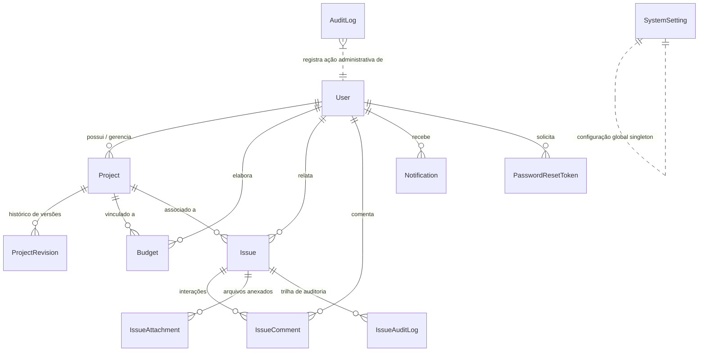

# Nacif Electric — Esquema do Banco de Dados & Dicionário de Dados

Este documento descreve a modelagem de dados da plataforma **Nacif Electric**, detalhando entidades, relacionamentos, integridade referencial, índices de performance e correspondência entre o **Prisma ORM** e as migrações SQL nativas.

---

## 1. Diagrama Entidade-Relacionamento (ERD)

---

## 2. Dicionário de Tabelas

### 2.1 `users` (Tabela de Usuários e Engenheiros)
Armazena as credenciais de acesso, papéis de permissão (RBAC), dados profissionais (CREA) e status de conta.

| Coluna | Tipo | Nulo | Padrão | Descrição |
| :--- | :--- | :---: | :--- | :--- |
| `id` | VARCHAR(191) | Não | cuid() | Chave Primária |
| `email` | VARCHAR(191) | Não | - | E-mail corporativo único |
| `passwordHash` | VARCHAR(191) | Não | - | Hash de senha com salitre criptográfico |
| `full_name` | VARCHAR(191) | Não | - | Nome completo do usuário |
| `role` | ENUM | Não | 'user' | Papel no sistema: `super_admin`, `admin`, `user` |
| `plan` | ENUM | Não | 'gratuito' | Plano de assinatura: `gratuito`, `profissional`, `engenharia` |
| `is_super_admin` | BOOLEAN | Não | FALSE | Flag indicadora de privilégio máximo de governança |
| `status` | VARCHAR(32) | Não | 'active' | Status da conta: `active`, `suspended`, `pending` |
| `profession` | VARCHAR(191) | Sim | NULL | Especialidade (eletricista, projetista, engenheiro) |
| `company` | VARCHAR(191) | Sim | NULL | Razão social ou nome fantasia |
| `crea` | VARCHAR(191) | Sim | NULL | Registro no Conselho Regional de Engenharia |
| `phone` | VARCHAR(191) | Sim | NULL | Telefone / WhatsApp para contato |
| `avatar_url` | LONGTEXT | Sim | NULL | URL ou Base64 da imagem de perfil |
| `custom_permissions` | JSON | Sim | NULL | Permissões granulares de módulos |
| `is_deleted` | BOOLEAN | Não | FALSE | Flag de exclusão lógica (LGPD) |
| `deleted_at` | DATETIME(3) | Sim | NULL | Data e hora do cancelamento/exclusão |
| `last_access` | DATETIME(3) | Sim | NULL | Data e hora do último acesso |
| `created_at` | DATETIME(3) | Não | CURRENT_TIMESTAMP | Timestamp de criação |
| `updated_at` | DATETIME(3) | Não | CURRENT_TIMESTAMP | Timestamp de última atualização |

**Índices:**
- `UNIQUE INDEX (email)`
- `INDEX (status)`
- `INDEX (role)`
- `INDEX (is_deleted)`

---

### 2.2 `projects` (Projetos Elétricos)
Repositório central de dados elétricos, diagramas unifilares, distribuição de circuitos e plantas baixas.

| Coluna | Tipo | Nulo | Padrão | Descrição |
| :--- | :--- | :---: | :--- | :--- |
| `id` | VARCHAR(191) | Não | cuid() | Chave Primária |
| `name` | VARCHAR(191) | Não | - | Nome identificador do projeto elétrico |
| `client_name` | VARCHAR(191) | Sim | NULL | Nome do cliente ou contratante |
| `address` | TEXT | Sim | NULL | Endereço da instalação |
| `project_type` | VARCHAR(191) | Sim | NULL | Tipo (Residencial, Comercial, Industrial, Solar) |
| `supply_type` | VARCHAR(191) | Sim | NULL | Padrão da concessionária: Monofásico, Bifásico, Trifásico |
| `voltage` | INTEGER | Sim | NULL | Tensão nominal (127V, 220V, 380V) |
| `circuits` | JSON | Sim | '[]' | Lista de circuitos com potência, condutor e proteção |
| `total_demand_w` | DOUBLE | Não | 0.0 | Demanda total calculada com fatores de simultaneidade |
| `panel_size` | INTEGER | Sim | NULL | Quantidade de módulos DIN no quadro principal |
| `panel_boards` | JSON | Sim | '[]' | Definição visual e disposição dos quadros (QDC) |
| `panel_layout` | JSON | Sim | NULL | Posições x, y dos disjuntores e trilhos DIN |
| `diagram_layout` | JSON | Sim | NULL | Roteamento ortogonal do diagrama unifilar |
| `plant_design` | JSON | Sim | NULL | Pontos elétricos e rotas de eletrodutos na planta |
| `plant_points_count` | INTEGER | Sim | 0 | Quantidade de pontos inseridos |
| `plant_routes_count` | INTEGER | Sim | 0 | Quantidade de trechos de tubulação |
| `plant_infra_type` | VARCHAR(191) | Sim | 'embutido' | Infraestrutura: embutido, aparente, eletrocalha |
| `status` | ENUM | Não | 'Rascunho' | `Rascunho`, `Em_Andamento`, `Concluido`, `Aprovado` |
| `notes` | TEXT | Sim | NULL | Memórias de cálculo e anotações do engenheiro |
| `materials` | JSON | Sim | '[]' | Lista quantitativa consolidada de materiais |
| `manual_budget_items`| JSON | Sim | '[]' | Insumos orçamentários inseridos manualmente |
| `created_by_id` | VARCHAR(191) | Não | - | Chave Estrangeira -> `users(id)` com `ON DELETE CASCADE` |
| `created_at` | DATETIME(3) | Não | CURRENT_TIMESTAMP | Timestamp de criação |
| `updated_at` | DATETIME(3) | Não | CURRENT_TIMESTAMP | Timestamp de última atualização |

---

### 2.3 `project_revisions` (Histórico de Auditoria de Projetos)
Garante a imutabilidade histórica das versões dos projetos elétricos para fins de rastreabilidade técnica e ART.

| Coluna | Tipo | Nulo | Descrição |
| :--- | :--- | :---: | :--- |
| `id` | VARCHAR(191) | Não | Chave Primária |
| `project_id` | VARCHAR(191) | Não | Chave Estrangeira -> `projects(id)` com `ON DELETE CASCADE` |
| `version` | INTEGER | Não | Número sequencial da revisão (1, 2, 3...) |
| `action` | VARCHAR(191) | Não | Ação causadora: `CREATE`, `UPDATE_CIRCUITS`, `REVISE_DIAGRAM` |
| `actor_user_id` | VARCHAR(191) | Não | ID do usuário que efetuou a alteração |
| `actor_email` | VARCHAR(191) | Não | E-mail do responsável técnico |
| `snapshot` | JSON | Não | Fotografia completa do estado do projeto |
| `summary` | TEXT | Sim | Descritivo sumarizado das mudanças |
| `created_at` | DATETIME(3) | Não | Momento exato da gravação da revisão |

**Índices:**
- `UNIQUE INDEX (project_id, version)`
- `INDEX (project_id, created_at)`

---

### 2.4 `budgets` (Orçamentos Financeiros e BDI)
Permite a precificação detalhada de materiais, serviços, encargos trabalhistas e aplicação de BDI.

| Coluna | Tipo | Nulo | Padrão | Descrição |
| :--- | :--- | :---: | :--- | :--- |
| `id` | VARCHAR(191) | Não | cuid() | Chave Primária |
| `name` | VARCHAR(191) | Não | - | Título descritivo da proposta orçamentária |
| `status` | ENUM | Não | 'Rascunho' | `Rascunho`, `Enviado`, `Aprovado`, `Recusado`, `Em_Revisao` |
| `margin` | DOUBLE | Não | 30.0 | Margem de lucro / BDI em porcentagem (0 a 100%) |
| `labor_cost` | DOUBLE | Não | 0.0 | Custo base estimado de mão de obra direta (R$) |
| `product_adjustment`| DOUBLE | Não | 0.0 | Ajuste percentual sobre produtos/materiais |
| `discount_type` | VARCHAR(32) | Não | 'percent' | Tipo de desconto: `percent` (%) ou `fixed` (R$) |
| `discount_value` | DOUBLE | Não | 0.0 | Montante do desconto concedido |
| `surcharge_type` | VARCHAR(32) | Não | 'percent' | Tipo de acréscimo: `percent` ou `fixed` |
| `surcharge_value` | DOUBLE | Não | 0.0 | Montante do acréscimo aplicado |
| `validity_days` | INTEGER | Não | 15 | Prazo de validade da proposta em dias corridos |
| `payment_terms` | VARCHAR(255) | Sim | - | Condições de pagamento combinadas |
| `execution_deadline`| VARCHAR(255) | Sim | - | Prazo estimado de conclusão da obra |
| `materials` | JSON | Sim | '[]' | Itens de insumos com preço unitário e quantitativo |
| `services` | JSON | Sim | '[]' | Atividades de montagem e mão de obra especializada |
| `client_info` | JSON | Sim | '{}' | Dados do cliente para cabeçalho da proposta comercial |
| `notes` | TEXT | Sim | NULL | Observações comerciais e escopo de responsabilidade |
| `version` | INTEGER | Não | 1 | Versão do orçamento para concorrência otimista |
| `project_id` | VARCHAR(191) | Sim | NULL | Chave Estrangeira -> `projects(id)` com `ON DELETE SET NULL` |
| `owner_id` | VARCHAR(191) | Não | - | Chave Estrangeira -> `users(id)` com `ON DELETE CASCADE` |
| `created_at` | DATETIME(3) | Não | CURRENT_TIMESTAMP | Timestamp de criação |
| `updated_at` | DATETIME(3) | Não | CURRENT_TIMESTAMP | Timestamp de alteração |

**Índices:**
- `INDEX (owner_id)`
- `INDEX (project_id)`
- `INDEX (status)`
- `INDEX (updated_at)`

---

### 2.5 `issues`, `issue_comments`, `issue_attachments`, `issue_audit_logs`
Conjunto relacional dedicado à **Central de Avisos e Erros**, permitindo o registro de bugs, sugestões e atendimento com SLAs rígidos.

- **`issues`:**
  - `protocol` (Único, ex: `NCF-ISSUE-202610-0042`)
  - `type` (`erro`, `aviso`)
  - `module` (`circuit-editor`, `single-line`, `panel-generator`, `budgets`, etc.)
  - `status` (`recebido`, `em_analise`, `em_correcao`, `resolvido`, `encerrado`)
  - `priority` (`baixa`, `media`, `alta`, `critica`)
  - `technical_info` (Dados do ambiente, navegador, memória)
  - `unread_user` / `unread_admin` (Controle visual de novas mensagens)
- **`issue_comments`:**
  - Comentários públicos ou notas internas (`is_internal = true`) para suporte entre engenheiros e administradores.
- **`issue_attachments`:**
  - Metadados e links para logs, capturas de tela e arquivos anexados ao chamado.
- **`issue_audit_logs`:**
  - Registro de todas as transições de status, transferências de responsável e edições.

---

### 2.6 `audit_logs` (Trilha de Governança e Super Admin)
Registra auditorias de ações críticas realizadas na plataforma para conformidade legal e segurança cibernética.

- `actor_id`, `actor_name`, `actor_email`, `actor_role`
- `action` (ex: `USER_SUSPENDED`, `DATABASE_BACKUP_EXPORTED`, `PASSWORD_RESET_SENT`)
- `target_type` (`user`, `project`, `budget`, `database`, `settings`)
- `target_id`, `target_name`, `details`, `metadata`
- `ip_address`, `user_agent`, `timestamp`

---

## 3. Integridade Referencial & Políticas de Exclusão

1. **Exclusão de Usuário (`ON DELETE CASCADE`):**
   - Ao excluir um usuário da base, todos os seus projetos (`projects`), orçamentos (`budgets`), notificações (`notifications`) e tokens são automaticamente removidos em cascata, evitando registros órfãos.
2. **Exclusão de Projeto (`ON DELETE SET NULL` em Orçamentos / Issues):**
   - Caso um projeto seja excluído, orçamentos e issues associados preservam seu histórico financeiro e registros de atendimento, tendo o campo `project_id` atualizado para `NULL`.
3. **Exclusão de Relato (`ON DELETE CASCADE` em Anexos e Comentários):**
   - A exclusão de uma issue limpa automaticamente seus comentários e anexos vinculados.

---

## 4. Concorrência Otimista (Optimistic Concurrency Control)

Para impedir que edições concorrentes de projetos ou orçamentos em diferentes abas ou navegadores sobrescrevam alterações silenciosamente:
- As tabelas `projects` e `budgets` contam com campo `version` sequencial e timestamp `updated_at`.
- Ao submeter um `PUT /api/budgets/:id`, o cliente envia `expected_updated_date`. Se houver divergência com o registro no banco, a requisição é rejeitada com código HTTP 409 (Conflict), preservando o trabalho anterior.
