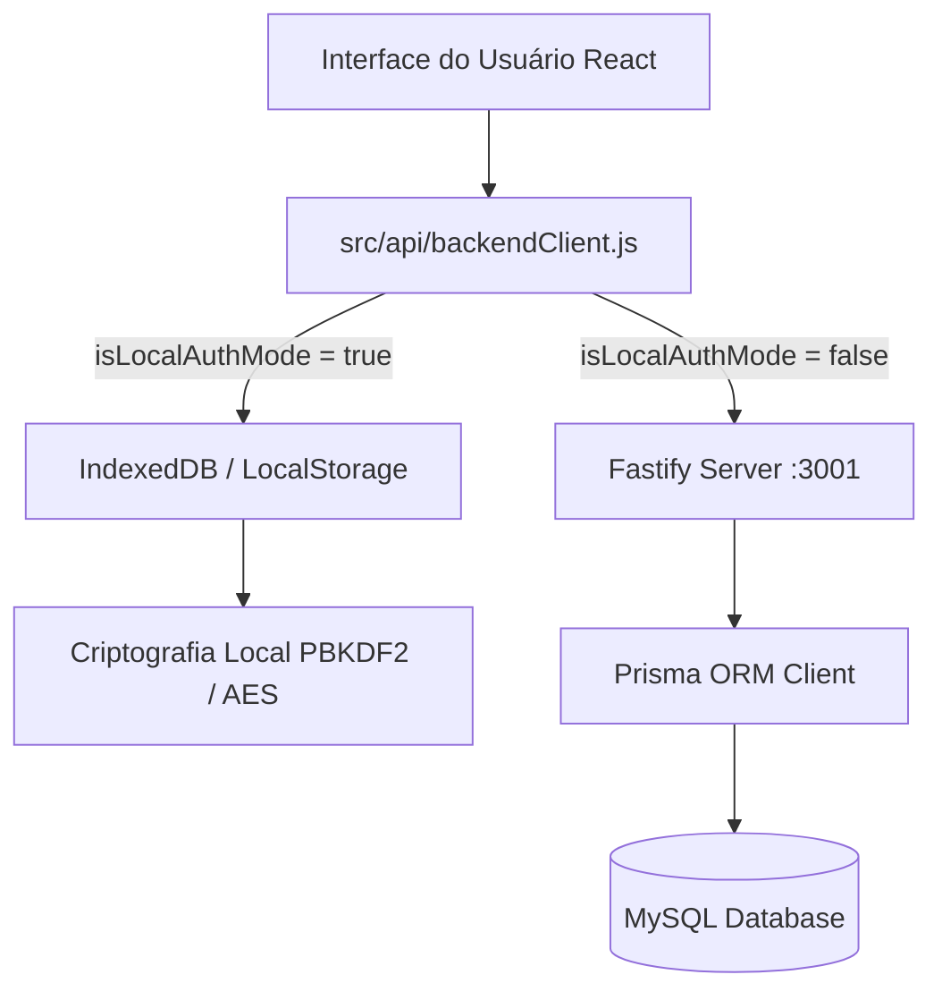

# Arquitetura do Projeto Nacif Eletric

Documento explicativo da estrutura de pastas, fluxos de dados, arquitetura full-stack e padrões de desenvolvimento da plataforma **Nacif Eletric**.

---

## 1. Estrutura Global do Projeto

```
nacif-eletric/
├── backend/                       # Backend Fastify + TypeScript + Prisma ORM (MySQL)
│   ├── prisma/                    # Modelagem relacional e migrações
│   │   ├── schema.prisma          # Esquema declarativo Prisma com todos os modelos
│   │   └── production-init.sql    # Script SQL de inicialização em produção
│   ├── src/                       # Código-fonte do servidor Fastify
│   │   ├── config/                # Variáveis de ambiente e caminhos
│   │   ├── lib/                   # Autenticação, serializers, erros e utilitários
│   │   ├── plugins/               # Plugins Fastify (JWT, CORS, Multipart)
│   │   ├── routes/                # Controladores REST (auth, projects, budgets, etc.)
│   │   ├── server.ts              # Ponto de entrada do servidor
│   │   └── app.ts                 # Configuração e inicialização da aplicação Fastify
│   ├── API_SPECIFICATION.md       # Especificação técnica completa de todas as rotas
│   ├── DATABASE_SCHEMA.md         # Dicionário de dados, ERD e integridade relacional
│   ├── SECURITY_AND_PERFORMANCE.md# Criptografia PBKDF2, RBAC, LGPD e SLAs
│   └── README.md                  # Guia de configuração e execução do backend
├── docs/                          # Documentação técnica e relatórios de auditoria
│   ├── ARCHITECTURE.md            # Visão geral da arquitetura full-stack
│   ├── RELATORIO_FINAL_CONSOLIDACAO_AUDITORIA_NACIF.md # Relatório e parecer final
│   ├── TUTORIAL_SUPER_ADMIN.md    # Manual operacional do Super Administrador
│   ├── MIGRATION_AVISOS_ERROS.md  # Documentação da Central de Avisos e Erros
│   ├── PANEL_GENERATOR_ROUTER.md  # Gerador de quadros e roteador ortogonal
│   └── UX_NAVIGATION_REFACTOR.md  # Especificação do fluxo de navegação e UX
├── public/                        # Assets estáticos públicos (ícones, manifest, favicon)
├── scripts/                       # Testes automatizados (smoke, E2E, roteador)
│   ├── master-e2e-final-audit.mjs # Suíte mestre de auditoria ponta a ponta
│   └── orthogonal-router-tests.mjs# Testes de roteamento de conexões ortogonais
├── src/                           # Aplicação Frontend React 19 + Vite
│   ├── api/                       # Camada de comunicação de dados
│   │   └── backendClient.js       # Cliente unificado (modo local/offline e modo REST API)
│   ├── components/                # Componentes reutilizáveis de UI
│   │   └── ui/                    # Primitivos base de interface
│   ├── context/                   # React Contexts (Autenticação, Notificações, etc.)
│   ├── db/                        # Migrações SQL e scripts de banco de dados
│   │   ├── migrationRunner.js     # Executor de migrações e auditoria de schema
│   │   └── migrations/            # Arquivos SQL de schema e versionamento
│   ├── hooks/                     # Custom React Hooks
│   ├── lib/                       # Motores de cálculo, segurança e integridade
│   │   ├── electricalEngine.js    # Cálculos elétricos NBR 5410, disjuntores, quedas de tensão
│   │   ├── orthogonalRouter.js    # Roteamento ortogonal e geometria 2D
│   │   ├── securityCrypto.js      # Criptografia PBKDF2-SHA256, AES-GCM e sanitização
│   │   ├── databaseIntegrityManager.js # Integridade, export/restore de backups e SHA-256
│   │   ├── issuePersistence.js    # Persistência da Central de Avisos e Erros
│   │   ├── auditLogger.js         # Trilha inviolável de auditoria
│   │   ├── budgetFinancialMath.js # Motor de cálculos de orçamentos, BDI e encargos
│   │   ├── incidentResponse.js    # Protocolo de resposta a incidentes e SLAs
│   │   └── infrastructureHealth.js# Telemetria e sondas de saúde do sistema
│   ├── pages/                     # Páginas e módulos da aplicação
│   │   ├── PanelGenerator.jsx     # Editor visual de quadros elétricos
│   │   ├── SingleLineDiagram.jsx  # Diagrama unifilar
│   │   ├── SolarWizard.jsx        # Assistente fotovoltaico NBR 16690
│   │   ├── Projects.jsx           # Gerenciamento de projetos elétricos
│   │   ├── Budget/                # Gestão orçamentária e financeira
│   │   ├── Issues/                # Central de Avisos e Erros
│   │   ├── SuperAdmin/            # Painel administrativo executivo
│   │   └── Settings/              # Preferências de conta e perfil
│   └── App.jsx                    # Roteamento central e inicialização
├── package.json                   # Dependências do frontend e scripts
├── tailwind.config.js             # Configuração do Tailwind CSS
└── vite.config.js                 # Configuração do Vite Bundler
```

---

## 2. Padrão Arquitetural Híbrido: Offline-First & API Centralizada

A plataforma foi arquitetada para operar de modo resiliente em dois cenários:



1. **Modo Local / Offline-First (`isLocalAuthMode = true`):**
   - Ideal para uso em canteiros de obras ou locais com conexão intermitente.
   - Os dados são mantidos localmente no navegador via `IndexedDB` e `LocalStorage`.
   - Criptografia e segurança locais são asseguradas por [`src/lib/securityCrypto.js`](../src/lib/securityCrypto.js) (PBKDF2-SHA256).
   - Backups completos com assinatura criptográfica SHA-256 podem ser exportados e restaurados a qualquer momento.

2. **Modo Centralizado / Servidor REST (`isLocalAuthMode = false`):**
   - Conecta a aplicação diretamente ao servidor Fastify (`backend/src/server.ts`).
   - Sincronização multiusuário, histórico de revisões em tempo real, auditoria centralizada para conformidade corporativa e processamento assistido por IA.

---

## 3. Padrões de Código e Boas Práticas

- **Rigor Matemático & Elétrico:** Todos os cálculos elétricos seguem estritamente as diretrizes da **NBR 5410** e **NBR 16690** (solar).
- **Proteção contra IDOR:** Nenhuma operação acessa ou altera dados sem validação expressa da titularidade do usuário autenticado.
- **Concorrência Otimista:** Atualizações de orçamentos e projetos utilizam controle de versão para impedir sobrescritas acidentais entre sessões simultâneas.
- **Validação de Testes Automatizados:**
  ```bash
  # Validação de testes ortogonais
  npm run test:orthogonal-router

  # Suíte mestre de auditoria ponta a ponta
  node scripts/e2eMasterAuditSuite.mjs

  # Compilação e verificação de build
  npm run build
  ```
- **Auto-Commit Obrigatório:** Todo ajuste concluído deve ser revisado via `git status`, adicionado com `git add` e commitado com mensagem Conventional Commits.
